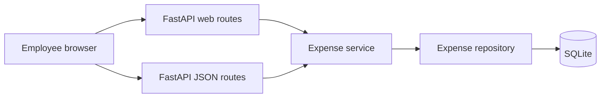

# Architecture — Smart Expense Management Portal

**Role:** Solution Architect  
**Sources:** [prd.md](prd.md), [requirements.md](requirements.md), [rules.md](../rules.md)  
**Status:** Draft for implementation. US-05 date-range design is awaiting approval.  
**Scope of this document:** Architecture design, API design, and database schema. No application code.

## 1. Summary

The portal is a single web application. FastAPI serves Bootstrap pages and a small JSON API. Expense data lives in one local SQLite file. Request handling is split into routes, a domain service, and a data-access boundary so each feature can be unit-tested without the database or the browser.



## 2. Architectural decisions

### ADR-1 — One deployable service

**Decision:** Ship one FastAPI process that renders the employee interface and exposes the JSON API.

**Why:** The product is four features for a single actor. A separate frontend build would add a second runtime without a requirement that needs it. Bootstrap pages stay in the same service as the API, which matches the stated stack and keeps Docker to one application container.

**Consequence:** UI and API share validation and totals logic through the expense service. A later split into a separate frontend can keep the JSON API unchanged.

### ADR-2 — Server-rendered Bootstrap UI

**Decision:** Render HTML with server templates and style it with Bootstrap. Forms post to the web routes. The JSON API exists for clients and tests.

**Why:** The product requirements name Bootstrap, not a JavaScript framework. Server-rendered pages meet add, list, filter, and dashboard with ordinary forms and links.

**Consequence:** Templates must encode dynamic values so expense titles cannot inject markup. Category filters are links or a form control limited to the allowed list.

### ADR-3 — SQLite as the local database

**Decision:** Store expenses in a single SQLite file on local disk. In Docker, mount that file on a volume so data survives container restarts.

**Why:** The product requirements and project rules both require SQLite for local use. The data model is one table and does not need a separate database server.

**Consequence:** SQLite allows one writer at a time. That is acceptable for this single-user local portal. The repository must use parameterized statements only.

### ADR-4 — Layered application

**Decision:** Keep three layers.

| Layer | Responsibility |
| --- | --- |
| Routes | HTTP, HTML forms, status codes, and mapping service results to pages or JSON. |
| Expense service | Field rules, totals, and list filtering by category and date range. No SQL and no HTTP. |
| Repository | Insert and query expenses. The only layer that touches SQLite. |

**Why:** Rules require unit tests for every feature. The service can be tested with an in-memory or fake repository. Routes stay thin.

**Consequence:** Dashboard math lives in the service, using the same records the list uses, so the two views cannot drift.

### ADR-5 — Validate at the boundary

**Decision:** Reject invalid title, amount, category, and date before any write. Use the same rules for form posts and JSON. Allowed categories are Travel, Meals, Supplies, Utilities, and Other.

**Why:** The product requirements call for input validation and OWASP-aligned secure coding. One rule set prevents the form and the API from disagreeing.

**Consequence:** Invalid requests return field errors. They do not create rows. Unexpected failures return a generic message and are logged on the server without secrets or stack traces in the response.

### ADR-6 — No authentication in this release

**Decision:** Do not add accounts or sessions. The expense list is shared on the machine where the app runs.

**Why:** The product requirements do not include sign-in. Adding it would widen scope.

**Consequence:** Anyone who can open the app can read and add expenses. This is acceptable only for a local demo. A later release that is exposed beyond the local machine needs authentication before it is shared.

### ADR-7 — Docker for deployment, secrets kept out of the image

**Decision:** Provide a container image that runs the FastAPI app and reads the SQLite path from the environment. Do not bake secrets, `.env` files, or the SQLite file into the image.

**Why:** The product requirements name Docker. Project rules forbid committing secrets and require approval before changing `.env` files.

**Consequence:** Deployment documentation lists the container, the data volume, and the database path. Implementation of the Docker files happens in a later build step.

### ADR-8 — Date range filters the list only

**Decision:** `GET /api/expenses` and `GET /expenses` accept optional query parameters `start` and `end`. Both bounds are inclusive. Either bound may be omitted. A blank bound is not applied. Filter dates must be real `YYYY-MM-DD` calendar dates and may be after today. A start date after the end date is a validation error, and the list is not returned. Category and date range combine with AND. The dashboard and `ExpenseStore.summarize` stay unfiltered.

**Why:** US-05, A-6, and A-9 through A-15 require this on the expense list only. The create-date rule rejects future dates and treats a missing date as an error, so filter dates need their own check. `start` and `end` are separate from the expense field `date`, and those names are the `field` values in the error list.

**Consequence:** `ExpenseStore.list_expenses` takes `category`, `start`, and `end`. `summarize` does not. `expense_date` stays an ISO `YYYY-MM-DD` string, which sorts chronologically, so the repository compares it with bound parameters. Invalid list filters return `422` and no expense rows, the same way an unknown category already does.

## 3. Runtime view

1. The employee opens the list, the add form, or the dashboard.
2. A web route calls the expense service.
3. The service validates input on write. On a list read it validates the category and date bounds, then asks the repository for rows. Dashboard reads skip those filters.
4. The repository runs a parameterized statement against SQLite.
5. The service returns expenses or totals. The route renders HTML or JSON.
6. If input is invalid, the service returns field errors and the route responds without writing.
7. If an unexpected error occurs, the route responds with a generic message and logs the detail on the server.

## 4. Database schema

One table, `expenses`. Identifiers are generated by the database. Amounts are stored as integers in the smallest currency unit (cents) so totals do not use binary floating point. The UI and API present the amount as a decimal with two places.

### Table: expenses

| Column | Type | Constraints | Description |
| --- | --- | --- | --- |
| id | integer | Primary key, autoincrement | Stable identifier. |
| title | text | Not null, length 1–100 after trim | Employee-entered label. |
| amount_cents | integer | Not null, greater than 0 | Amount in cents. |
| category | text | Not null, one of the five allowed values | Spending category. |
| expense_date | text | Not null, ISO date `YYYY-MM-DD`, on or before the current local date | Date the expense occurred. |
| created_at | text | Not null, ISO-8601 timestamp | When the row was stored. |

### Access patterns

| Need | Query shape |
| --- | --- |
| List all | All rows, newest `expense_date` first, then `id` descending. |
| Filter by category | Same order, restricted to one allowed category. |
| Filter by date | Same order. `expense_date >= start` when `start` is set. `expense_date <= end` when `end` is set. Both comparisons are inclusive. |
| Filter by category and date | Same order. Category equality and the date comparisons are combined with AND. |
| Dashboard | Sum of `amount_cents` overall, and sum of `amount_cents` grouped by `category`. No category or date predicate. Categories with a zero sum are omitted. |

No other tables are required. Category is stored on the expense row because the list is fixed and small.

## 5. API design

Dates and timestamps are ISO-8601. Amounts in JSON are decimal strings with two places, for example `"12.50"`. The server converts to and from `amount_cents`.

### Resources

| Method | Path | Purpose |
| --- | --- | --- |
| POST | `/api/expenses` | Create one expense. |
| GET | `/api/expenses` | List expenses. Optional `category`, `start`, and `end` queries. |
| GET | `/api/dashboard` | Overall total and totals per category. |
| GET | `/health` | Process is up. Does not check business data. |

### POST `/api/expenses`

Request body:

| Field | JSON type | Rules |
| --- | --- | --- |
| title | string | Required. Trimmed length 1–100. |
| amount | string | Required. Decimal greater than 0 with at most two places. |
| category | string | Required. Travel, Meals, Supplies, Utilities, or Other. |
| date | string | Required. `YYYY-MM-DD`, not after today. |

Success: `201 Created` and the stored expense.

```json
{
  "id": 1,
  "title": "Client visit",
  "amount": "48.00",
  "category": "Travel",
  "date": "2026-11-01"
}
```

Validation failure: `422 Unprocessable Entity`.

```json
{
  "errors": [
    { "field": "amount", "message": "Amount must be greater than 0." }
  ]
}
```

### GET `/api/expenses`

Query parameters are optional and combine with AND. A missing or blank parameter does not apply that bound. Rules, messages, and status codes are in section 11.

| Parameter | Required | Rule |
| --- | --- | --- |
| category | No | An allowed category, or omitted. |
| start | No | Inclusive lower bound. `YYYY-MM-DD`. May be after today. |
| end | No | Inclusive upper bound. `YYYY-MM-DD`. May be after today. |

Success: `200 OK`. An allowed filter that matches nothing returns an empty `expenses` array.

```json
{
  "expenses": [
    {
      "id": 1,
      "title": "Client visit",
      "amount": "48.00",
      "category": "Travel",
      "date": "2026-11-01"
    }
  ]
}
```

Invalid `category`, `start`, or `end`, or a start date after the end date: `422` and the error list from section 11. The response has no `expenses` array.

### GET `/api/dashboard`

Success: `200 OK`. `total` is the sum of all expenses. `byCategory` includes only categories that have expenses. Each `total` is a decimal string.

```json
{
  "total": "73.50",
  "byCategory": [
    { "category": "Travel", "total": "48.00" },
    { "category": "Meals", "total": "25.50" }
  ]
}
```

When there are no expenses, `total` is `"0.00"` and `byCategory` is an empty array.

### Error model

| Situation | HTTP status | Body |
| --- | --- | --- |
| Invalid field or query | 422 | `{ "errors": [{ "field", "message" }] }` |
| Wrong JSON shape or unknown field that cannot be parsed | 422 | Same error list, field `body` when the payload is not an object |
| Unexpected failure | 500 | `{ "message": "Something went wrong. Try again." }` |

Responses never include stack traces, SQL, filesystem paths, or environment values.

## 6. Web interface

The browser uses these pages. They call the same service as the JSON API.

| Method | Path | Behavior |
| --- | --- | --- |
| GET | `/expenses` | List. Optional `category`, `start`, and `end` queries apply together. The form can clear dates without clearing the category, and clear the category without clearing the dates. |
| GET | `/expenses/new` | Empty add form. |
| POST | `/expenses` | Valid submission redirects to `/expenses`. Invalid submission re-renders the form with field errors and the submitted values. |
| GET | `/dashboard` | Shows overall total and one row per category that has expenses. |
| GET | `/` | Redirects to `/dashboard`. |

Page layout uses Bootstrap. Amounts display with two decimal places. Dates display as `YYYY-MM-DD`.

## 7. Security

| Practice | Application |
| --- | --- |
| Input validation | All four expense fields, plus the `category`, `start`, and `end` list queries, are checked before use. |
| Injection | Repository statements are parameterized. Expense text is never concatenated into SQL. |
| Output encoding | Templates encode title and other stored text when rendering HTML. |
| Error handling | Callers see field messages or one generic failure message. Details stay in server logs. |
| Secrets | No credentials are required for local SQLite. None are committed. Environment files are not edited without approval. |
| Data exposure | This release has no authentication. Keep the app on the local machine. |
| Transport | Local demo may use HTTP. A shared deployment should terminate TLS in front of the container. |

## 8. Deployment shape

One application container runs the FastAPI process. A volume holds the SQLite file. The database path is configuration, not a value baked into the image. Health is available at `/health`. Direct pushes to the main branch are outside the delivery path described here.

Docker artifacts themselves are a later implementation deliverable. This document only fixes the runtime shape those artifacts must satisfy.

## 9. Test focus

Keep the existing add, view, category-filter, and dashboard cases. Add the date-range cases below, grouped by layer. Service tests use a fake `ExpenseStore`. Repository tests use SQLite. API and web tests use the HTTP client.

### Validation

- Omitted, empty, and whitespace-only `start` and `end` become “not applied”, including when `category` is also omitted.
- A valid start only, a valid end only, equal bounds, and a start before the end are accepted. A filter date after today is accepted.
- A non-date, a partial date, and an impossible calendar date each fail. The error field is `start`, `end`, or both when both fail.
- When both dates are valid and the start is after the end, the only added error is on `start`. That order error is not added when either date failed to parse.
- An unknown category fails with the existing category message. An unknown category together with an invalid date returns both errors.
- An allowed category is returned unchanged.

### Service

- A valid category, start, and end are passed through to `list_expenses` on the store. The store is not called when validation fails.
- Start only, end only, and an inclusive range return the matching rows. Category and date range both apply.
- A valid range with no matches returns an empty list and does not raise.
- `dashboard` still sums every stored expense after a ranged list call. It never receives `start` or `end`.
- Existing add, view, unknown-category, and empty-store cases still pass with the new `list_expenses` arguments.

### Repository

- Rows before, on, and after the bounds: both bounds are inclusive. Start only and end only match A-10.
- Category and date range together exclude a row that fails either predicate. Order stays `expense_date` descending, then `id` descending.
- A range with no matches returns an empty list. `summarize` on the same store still totals every row.
- Date predicates are bound parameters. A title that contains quotes still round-trips.

### JSON API

- `GET /api/expenses` with a valid start, a valid end, and both returns `200` and only the matching expenses.
- A valid range with no rows returns `200` and `"expenses": []`.
- A start after the end returns `422`, field `start`, and no `expenses` array.
- An invalid start, an invalid end, and both invalid return `422` with those fields named.
- `category` plus a valid range returns only rows that match both. The dashboard total is unchanged while that filter is available on the list.

### Web

- The list form shows Start date and End date and keeps a valid category selected.
- A valid range shows only matching rows. A valid range with no rows shows the filtered empty state and no error.
- A start after the end, and an invalid bound, return `422`. The table and the empty state are absent. Every failing field is visible. The submitted date text is still in the form.
- Clearing dates keeps the selected category. Choosing all categories and filtering again keeps the dates.
- The dashboard still shows the total of every stored expense while the list has a date range.

## 10. Requirement mapping

| Requirement area | Design element |
| --- | --- |
| Add, view, filter, dashboard | Web routes, JSON API, expense service |
| Field rules | Boundary validation in the service |
| Totals | `amount_cents` sums in the dashboard query, formatted by the service |
| SQLite local | `expenses` table and repository |
| OWASP, validation, errors | Section 7 and the error model |
| Pytest | Section 9 |
| Docker | Section 8 |
| Documented decisions | Section 2 |
| Date-range list filter | ADR-8 and section 11 |

## 11. Date-range list filter (US-05)

This section is the implementation contract for the date-range filter. No schema change. `amount_cents`, create validation, `POST /api/expenses`, and `GET /api/dashboard` stay as they are.

### Validation

Add a `ListFilters` value with `category`, `start`, and `end`. Each field is either a normalized string or absent. Add `validate_list_filters(category, start, end)`, used by the service for every list. Fold the current category check into it so one `ValidationFailed` can carry the category error and the date errors together.

Parse each bound with a new optional-date check. Do not call the create-date helper: that helper requires a date and rejects dates after today. For each bound:

- Missing, empty, or whitespace-only becomes “not applied”.
- Any other value must match `YYYY-MM-DD` and be a real calendar date. `2026-02-31`, `2026-11-1`, and `11/01/2026` fail.
- Do not compare a filter date with today.
- A non-string value fails that field. HTML forms send strings. The JSON query string is also text.

If both bounds parse and the start is after the end, add one error on `start` and do not add it when either bound failed to parse. Return the errors in this order: `category`, `start`, `end`, then the order error.

| Condition | Field | Message |
| --- | --- | --- |
| Unusable start | `start` | Start date must be a valid date (YYYY-MM-DD). |
| Unusable end | `end` | End date must be a valid date (YYYY-MM-DD). |
| Start after end | `start` | Start date must be on or before the end date. |
| Category outside the list | `category` | Category must be one of: Travel, Meals, Supplies, Utilities, Other. |

### Service

`list_expenses` takes `category`, `start`, and `end`. It validates first. On success it calls `store.list_expenses` with the three normalized values. On failure it raises `ValidationFailed` and does not call the store.

`dashboard` takes no filter arguments and still calls `summarize` only.

### Repository and `ExpenseStore`

`list_expenses(self, category: str | None, start: str | None, end: str | None) -> list[ExpenseRecord]`. `add` and `summarize` stay the same.

`SqlAlchemyExpenseRepository.list_expenses` keeps the current order and adds bound predicates only when the argument is not `None`:

- `category` equal to the given category
- `expense_date` greater than or equal to `start`
- `expense_date` less than or equal to `end`

The predicates are AND. Nothing is concatenated into SQL. `summarize` has no category or date predicate.

### JSON API

`GET /api/expenses` reads optional query parameters `category`, `start`, and `end` and passes them to the service.

| Outcome | Status | Body |
| --- | --- | --- |
| Bounds omitted, or valid bounds | 200 | `{ "expenses": [ ... ] }` |
| Valid filters, no rows | 200 | `{ "expenses": [] }` |
| Invalid category, start, or end, or start after end | 422 | `{ "errors": [{ "field", "message" }] }` for every failing field |
| Unexpected failure | 500 | `{ "message": "Something went wrong. Try again." }` |

A `422` body does not include an `expenses` array. `GET /api/dashboard` declares none of these parameters and continues to total every stored expense.

### Web route

`GET /expenses` uses the same three query parameters and the same service method.

| Outcome | Status | Page |
| --- | --- | --- |
| Valid filters, including a range with no rows | 200 | Table, or the empty state when the table would be empty |
| Any list-filter validation error | 422 | No table and no empty state. Every error message is shown. |

On an error, put the submitted `start` and `end` text back in the form. Keep `selected` only when `category` is an allowed value. A rejected category is not copied into the select, because it is not one of the options.

`GET /dashboard` is unchanged and does not read `start` or `end`.

### Template

The list form stays `GET /expenses` and gains Start date and End date controls named `start` and `end`, beside the category select. Empty controls omit that bound.

Show each filter error. When `errors` is present, do not render the table or the “no expenses” copy.

Empty copy when the filter is valid: “No expenses match these filters.” if a category, start, or end is active, and “No expenses yet.” if none are.

Clear the two filters independently:

- Clear dates with a link to `/expenses` when no category is selected, or `/expenses?category=<selected>` when one is. Show that link only when a date bound is active.
- Clear the category by choosing “All categories” and submitting the form, which still sends the current start and end.

One clear control must not drop the category and the dates together. Stored titles stay encoded by the template.

## 12. Optional Streamlit deployment interface

**Decision:** Provide `streamlit_app.py` as an additional presentation entry point for Streamlit Community Cloud. Keep the FastAPI + Bootstrap application and Dockerfile as the original deployment path.

**Layering:** The Streamlit page creates an `ExpenseService` with a SQLAlchemy repository and calls the same `create`, `list_expenses`, and `dashboard` methods as the FastAPI routes. It contains presentation and form handling only; it does not implement SQL, expense validation, or total calculations.

**Persistence and exposure:** The Streamlit entry point uses the configured `DATABASE_PATH`, defaulting to the local SQLite file. Streamlit Community Cloud does not guarantee persistence for local files, so deployed SQLite data is suitable only for a disposable demonstration. Use a persistent external database for durable records. The release has no authentication, so the Streamlit URL must be treated as public and must not be used for confidential expense data.
