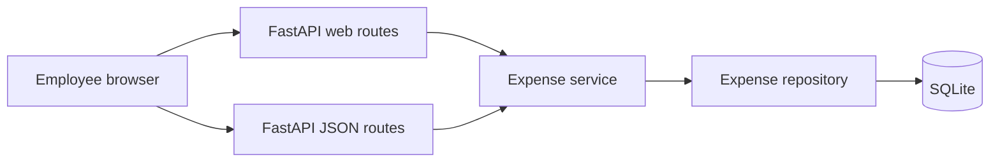

# Architecture — Smart Expense Management Portal

**Role:** Solution Architect  
**Sources:** [prd.md](prd.md), [requirements.md](requirements.md), [rules.md](../rules.md)  
**Status:** Draft for implementation  
**Scope of this document:** Architecture design, API design, and database schema. No application code.

## 1. Summary

The portal is a single web application. FastAPI serves Bootstrap pages and a small JSON API. Expense data lives in one local SQLite file. Request handling is split into routes, a domain service, and a data-access boundary so each feature can be unit-tested without the database or the browser.



## 2. Architectural decisions

### ADR-1 — One deployable service

**Decision:** Ship one FastAPI process that renders the employee interface and exposes the JSON API.

**Why:** The product is four features for a single actor. A separate frontend build would add a second runtime without a requirement that needs it. Bootstrap pages stay in the same service as the API, which matches the stated stack and keeps Docker to one application container.

**Consequence:** UI and API share validation and totals logic through the expense service. A later split into a separate frontend can keep the JSON API unchanged.

### ADR-2 — Server-rendered Bootstrap UI

**Decision:** Render HTML with server templates and style it with Bootstrap. Forms post to the web routes. The JSON API exists for clients and tests.

**Why:** The product requirements name Bootstrap, not a JavaScript framework. Server-rendered pages meet add, list, filter, and dashboard with ordinary forms and links.

**Consequence:** Templates must encode dynamic values so expense titles cannot inject markup. Category filters are links or a form control limited to the allowed list.

### ADR-3 — SQLite as the local database

**Decision:** Store expenses in a single SQLite file on local disk. In Docker, mount that file on a volume so data survives container restarts.

**Why:** The product requirements and project rules both require SQLite for local use. The data model is one table and does not need a separate database server.

**Consequence:** SQLite allows one writer at a time. That is acceptable for this single-user local portal. The repository must use parameterized statements only.

### ADR-4 — Layered application

**Decision:** Keep three layers.

| Layer | Responsibility |
| --- | --- |
| Routes | HTTP, HTML forms, status codes, and mapping service results to pages or JSON. |
| Expense service | Field rules, totals, and category filtering. No SQL and no HTTP. |
| Repository | Insert and query expenses. The only layer that touches SQLite. |

**Why:** Rules require unit tests for every feature. The service can be tested with an in-memory or fake repository. Routes stay thin.

**Consequence:** Dashboard math lives in the service, using the same records the list uses, so the two views cannot drift.

### ADR-5 — Validate at the boundary

**Decision:** Reject invalid title, amount, category, and date before any write. Use the same rules for form posts and JSON. Allowed categories are Travel, Meals, Supplies, Utilities, and Other.

**Why:** The product requirements call for input validation and OWASP-aligned secure coding. One rule set prevents the form and the API from disagreeing.

**Consequence:** Invalid requests return field errors. They do not create rows. Unexpected failures return a generic message and are logged on the server without secrets or stack traces in the response.

### ADR-6 — No authentication in this release

**Decision:** Do not add accounts or sessions. The expense list is shared on the machine where the app runs.

**Why:** The product requirements do not include sign-in. Adding it would widen scope.

**Consequence:** Anyone who can open the app can read and add expenses. This is acceptable only for a local demo. A later release that is exposed beyond the local machine needs authentication before it is shared.

### ADR-7 — Docker for deployment, secrets kept out of the image

**Decision:** Provide a container image that runs the FastAPI app and reads the SQLite path from the environment. Do not bake secrets, `.env` files, or the SQLite file into the image.

**Why:** The product requirements name Docker. Project rules forbid committing secrets and require approval before changing `.env` files.

**Consequence:** Deployment documentation lists the container, the data volume, and the database path. Implementation of the Docker files happens in a later build step.

## 3. Runtime view

1. The employee opens the list, the add form, or the dashboard.
2. A web route calls the expense service.
3. The service validates input on write, or asks the repository for rows on read.
4. The repository runs a parameterized statement against SQLite.
5. The service returns expenses or totals. The route renders HTML or JSON.
6. If input is invalid, the service returns field errors and the route responds without writing.
7. If an unexpected error occurs, the route responds with a generic message and logs the detail on the server.

## 4. Database schema

One table, `expenses`. Identifiers are generated by the database. Amounts are stored as integers in the smallest currency unit (cents) so totals do not use binary floating point. The UI and API present the amount as a decimal with two places.

### Table: expenses

| Column | Type | Constraints | Description |
| --- | --- | --- | --- |
| id | integer | Primary key, autoincrement | Stable identifier. |
| title | text | Not null, length 1–100 after trim | Employee-entered label. |
| amount_cents | integer | Not null, greater than 0 | Amount in cents. |
| category | text | Not null, one of the five allowed values | Spending category. |
| expense_date | text | Not null, ISO date `YYYY-MM-DD`, on or before the current local date | Date the expense occurred. |
| created_at | text | Not null, ISO-8601 timestamp | When the row was stored. |

### Access patterns

| Need | Query shape |
| --- | --- |
| List all | All rows, newest `expense_date` first, then `id` descending. |
| Filter | Same order, restricted to one allowed category. |
| Dashboard | Sum of `amount_cents` overall, and sum of `amount_cents` grouped by `category`. Categories with a zero sum are omitted. |

No other tables are required. Category is stored on the expense row because the list is fixed and small.

## 5. API design

Dates and timestamps are ISO-8601. Amounts in JSON are decimal strings with two places, for example `"12.50"`. The server converts to and from `amount_cents`.

### Resources

| Method | Path | Purpose |
| --- | --- | --- |
| POST | `/api/expenses` | Create one expense. |
| GET | `/api/expenses` | List expenses. Optional `category` query. |
| GET | `/api/dashboard` | Overall total and totals per category. |
| GET | `/health` | Process is up. Does not check business data. |

### POST `/api/expenses`

Request body:

| Field | JSON type | Rules |
| --- | --- | --- |
| title | string | Required. Trimmed length 1–100. |
| amount | string | Required. Decimal greater than 0 with at most two places. |
| category | string | Required. Travel, Meals, Supplies, Utilities, or Other. |
| date | string | Required. `YYYY-MM-DD`, not after today. |

Success: `201 Created` and the stored expense.

```json
{
  "id": 1,
  "title": "Client visit",
  "amount": "48.00",
  "category": "Travel",
  "date": "2026-11-01"
}
```

Validation failure: `422 Unprocessable Entity`.

```json
{
  "errors": [
    { "field": "amount", "message": "Amount must be greater than 0." }
  ]
}
```

### GET `/api/expenses`

Query: `category` optional. When present, it must be an allowed category. A missing parameter returns every expense.

Success: `200 OK`.

```json
{
  "expenses": [
    {
      "id": 1,
      "title": "Client visit",
      "amount": "48.00",
      "category": "Travel",
      "date": "2026-11-01"
    }
  ]
}
```

Unknown category: `422` with a category field error. An allowed category with no rows returns `200` and an empty `expenses` array.

### GET `/api/dashboard`

Success: `200 OK`. `total` is the sum of all expenses. `byCategory` includes only categories that have expenses. Each `total` is a decimal string.

```json
{
  "total": "73.50",
  "byCategory": [
    { "category": "Travel", "total": "48.00" },
    { "category": "Meals", "total": "25.50" }
  ]
}
```

When there are no expenses, `total` is `"0.00"` and `byCategory` is an empty array.

### Error model

| Situation | HTTP status | Body |
| --- | --- | --- |
| Invalid field or query | 422 | `{ "errors": [{ "field", "message" }] }` |
| Wrong JSON shape or unknown field that cannot be parsed | 422 | Same error list, field `body` when the payload is not an object |
| Unexpected failure | 500 | `{ "message": "Something went wrong. Try again." }` |

Responses never include stack traces, SQL, filesystem paths, or environment values.

## 6. Web interface

The browser uses these pages. They call the same service as the JSON API.

| Method | Path | Behavior |
| --- | --- | --- |
| GET | `/expenses` | List. Optional `category` query applies the filter. Includes a control to clear the filter. |
| GET | `/expenses/new` | Empty add form. |
| POST | `/expenses` | Valid submission redirects to `/expenses`. Invalid submission re-renders the form with field errors and the submitted values. |
| GET | `/dashboard` | Shows overall total and one row per category that has expenses. |
| GET | `/` | Redirects to `/dashboard`. |

Page layout uses Bootstrap. Amounts display with two decimal places. Dates display as `YYYY-MM-DD`.

## 7. Security

| Practice | Application |
| --- | --- |
| Input validation | All four fields, plus the category query, are checked before use. |
| Injection | Repository statements are parameterized. Expense text is never concatenated into SQL. |
| Output encoding | Templates encode title and other stored text when rendering HTML. |
| Error handling | Callers see field messages or one generic failure message. Details stay in server logs. |
| Secrets | No credentials are required for local SQLite. None are committed. Environment files are not edited without approval. |
| Data exposure | This release has no authentication. Keep the app on the local machine. |
| Transport | Local demo may use HTTP. A shared deployment should terminate TLS in front of the container. |

## 8. Deployment shape

One application container runs the FastAPI process. A volume holds the SQLite file. The database path is configuration, not a value baked into the image. Health is available at `/health`. Direct pushes to the main branch are outside the delivery path described here.

Docker artifacts themselves are a later implementation deliverable. This document only fixes the runtime shape those artifacts must satisfy.

## 9. Test focus

Unit tests cover the expense service, with a fake repository where persistence is not the subject.

| Feature | Cases |
| --- | --- |
| Add | Valid expense is stored. Each invalid field is rejected and nothing is stored. |
| View | All stored expenses are returned. An empty store returns an empty list. |
| Filter | One category returns only that category. An unknown category is rejected. A category with no rows returns an empty list. |
| Dashboard | Empty store returns zero. Totals match the sum of stored amounts. A list filter does not change dashboard totals. |

Repository tests, kept separate, confirm parameterized writes and reads against SQLite. They are not a substitute for the service cases above.

## 10. Requirement mapping

| Requirement area | Design element |
| --- | --- |
| Add, view, filter, dashboard | Web routes, JSON API, expense service |
| Field rules | Boundary validation in the service |
| Totals | `amount_cents` sums in the dashboard query, formatted by the service |
| SQLite local | `expenses` table and repository |
| OWASP, validation, errors | Section 7 and the error model |
| Pytest | Section 9 |
| Docker | Section 8 |
| Documented decisions | Section 2 |
